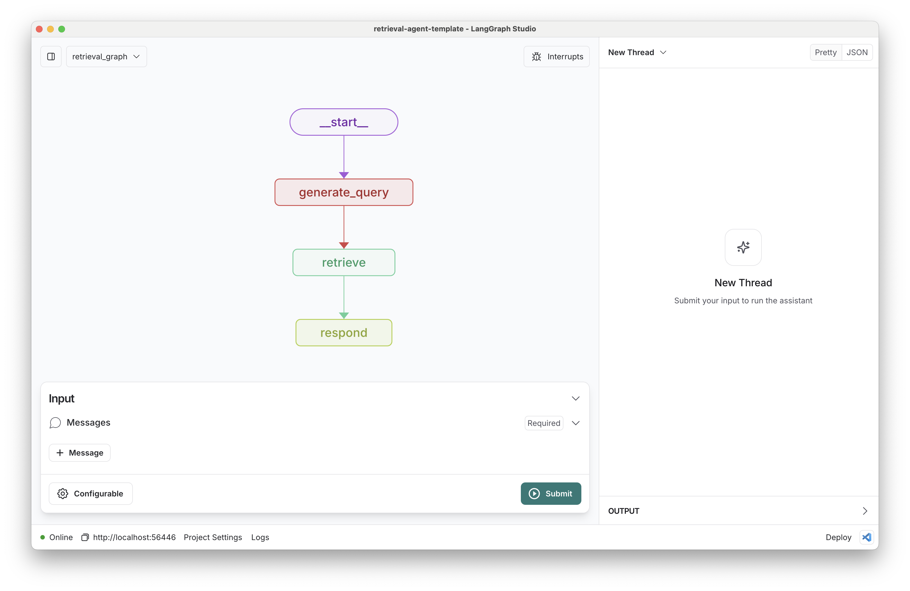
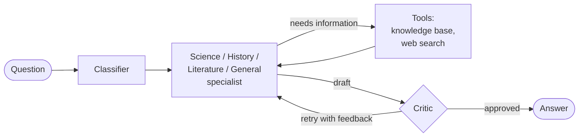
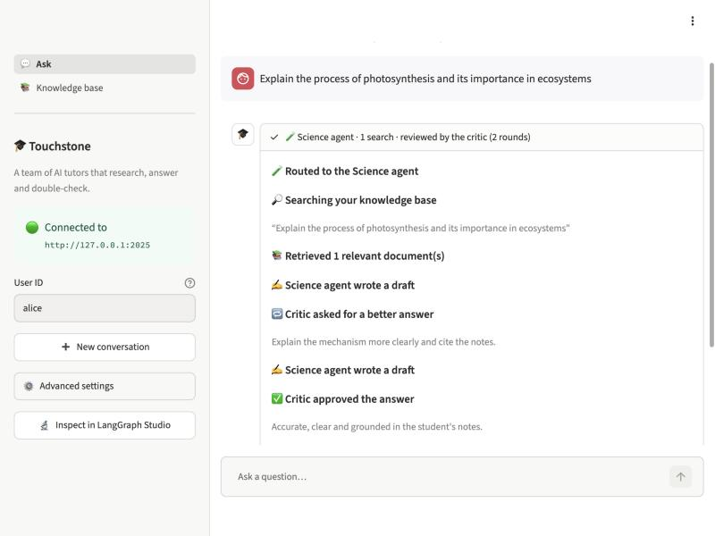

# Touchstone: Multi-Agent Orchestration with Routing and Critic Review

[](https://github.com/sahajrajmalla/touchstone/actions/workflows/ci.yml)

An intelligent multi-agent system for knowledge retrieval and reasoning in education,
built with [LangGraph](https://github.com/langchain-ai/langgraph).

Ask Touchstone a question and a small team of AI agents works on it: a **router** sends
it to a **science, history, literature or general specialist**; the specialist searches
**your own study material** (and, optionally, the web) before answering; and a
**critic** reviews every answer, sending weak ones back for another attempt.



## Quick start

You need [uv](https://docs.astral.sh/uv/getting-started/installation/) (it installs Python
for you), an [Anthropic API key](https://console.anthropic.com/) and a
[Google AI API key](https://aistudio.google.com/app/apikey).
[Docker](https://docs.docker.com/get-docker/) is recommended for the local Elasticsearch.

```bash
git clone https://github.com/sahajrajmalla/touchstone.git
cd touchstone
make quickstart
```

The first run installs everything, creates `.env` and tells you which keys to add. Add
them, then run `make quickstart` again: it checks your setup, starts Elasticsearch in
Docker and opens the web UI.

| What | Where |
| --- | --- |
| Web UI | <http://localhost:8501> |
| LangGraph API | <http://127.0.0.1:2024> |
| LangGraph Studio | <https://smith.langchain.com/studio/?baseUrl=http://127.0.0.1:2024> |

Something not working? Run `make doctor` - it checks every requirement and tells you how
to fix what is missing. See also [Troubleshooting](docs/troubleshooting.md).

## How it works



- **Routing** - a fast model classifies each question into a subject.
- **Retrieval** - specialists search the asking user's knowledge base in Elasticsearch
  (documents are private to each user ID) and can search the web with Tavily.
- **Quality control** - the critic accepts the draft or sends it back with feedback.
- **Guardrails** - each question gets at most 3 search rounds and 2 critic retries, so a
  run always ends with an answer.

Two graphs are served (see [`langgraph.json`](langgraph.json)): `retrieval_graph` answers
questions and `indexer` adds documents - plain text, web pages or PDFs (by URL). Details:
[Architecture](docs/architecture.md).

## Using Touchstone

**Web UI** (`make start`). Enter a **User ID** in the sidebar, add notes, URLs or files on
the **Knowledge base** page, then ask on the **Ask** page. A live trace shows how the agents
worked, and each answer lists its sources. See the [UI guide](docs/ui.md).



**LangGraph Studio** (`make dev`). Visualise the graph, inspect state at every step and
re-run from any node. Select the `indexer` or `retrieval_graph` graph and set `user_id` in
the configuration panel.

**Python**:

```python
import asyncio

from retrieval_graph import graph, index_graph


async def main() -> None:
    context = {"user_id": "alice"}  # run settings: user, models, search
    await index_graph.ainvoke(
        {"docs": ["Photosynthesis converts light energy into chemical energy."]},
        context=context,
    )
    result = await graph.ainvoke(
        {"messages": [("user", "What is photosynthesis?")]}, context=context
    )
    print(result["messages"][-1].content)


asyncio.run(main())
```

## Configuration

Keys and connection settings live in `.env` ([template](.env.example)):

| Variable | Required | Purpose |
| --- | --- | --- |
| `ANTHROPIC_API_KEY` | yes | Default language models (Claude) |
| `GOOGLE_API_KEY` | yes | Embeddings for indexing and search |
| `ELASTICSEARCH_URL`, `_USER`, `_PASSWORD` | yes | Knowledge base storage |
| `TAVILY_API_KEY` | no | Web search |
| `USER_ID` | no | Default user ID |
| `LANGSMITH_API_KEY` | no | Tracing in LangSmith |

Per-run settings - models, web search, number of documents retrieved - are set in the UI
sidebar, in Studio's configuration panel or with `context={...}` in code. The defaults are
`anthropic/claude-sonnet-5-5` for answers and critique, `anthropic/claude-haiku-5-5` for
routing and `google/gemini-embedding-001` for embeddings. Full reference:
[Configuration](docs/configuration.md).

## Commands

| Command | What it does |
| --- | --- |
| `make quickstart` | Install, configure, check and start everything |
| `make start` | Start the backend and the web UI together |
| `make dev` | Start the LangGraph server and open LangGraph Studio |
| `make doctor` | Check keys, Elasticsearch and the backend |
| `make es-up` / `make es-down` | Start / stop the local Elasticsearch (Docker) |
| `make test` | Run the unit tests (offline - no keys needed) |
| `make check` | Lint, type-check and test - what CI runs |

`make help` lists every command.

## Project structure

```text
src/
  retrieval_graph/        LangGraph agents (the backend)
    graph.py              classify -> specialist <-> tools -> critique -> respond
    index_graph.py        text and URLs -> Elasticsearch
    configuration.py      run configuration (models, user_id, search settings)
    state.py              graph state and reducers
    retrieval.py          user-scoped Elasticsearch retriever
    prompts.py            prompts for the classifier, specialists and critic
    utils.py              formatting, model loading, web/PDF text extraction
  touchstone_ui/          Streamlit web UI - a client of the LangGraph API
tests/
  unit_tests/             offline tests (scripted models, in-memory store)
  integration_tests/      live tests (API keys + Elasticsearch)
scripts/                  doctor.py and start.py, used by make
docs/                     documentation
langgraph.json            graphs served by `langgraph dev` / LangGraph Platform
docker-compose.yml        local Elasticsearch
```

## Development

```bash
make setup        # install everything (also creates .env)
make test-watch   # re-run the tests on every change
make check        # lint + strict type-check + tests
make hooks        # optional: run the formatters before each commit
```

CI runs `make check`'s steps on Python 3.11-3.13 for every pull request. Read the
[Development guide](docs/development.md) - including how to add a new specialist agent -
and [CONTRIBUTING.md](CONTRIBUTING.md).

## Documentation

- [Architecture](docs/architecture.md) - graphs, state, guardrails and design decisions
- [Configuration](docs/configuration.md) - every setting, model choices, upgrade notes
- [Web UI](docs/ui.md) - using and customising the UI
- [Elasticsearch](docs/elasticsearch.md) - local setup, existing clusters, Docker networking
- [Development](docs/development.md) - workflow, testing, extending Touchstone
- [Troubleshooting](docs/troubleshooting.md) - common errors and fixes
- [Changelog](CHANGELOG.md)

## Project information

**Version**: 0.0.1
**Author**: Sahaj Raj Malla (mallasahajraj@gmail.com)
**License**: [MIT](LICENSE)

Built with LangGraph and LangChain, Elasticsearch, Anthropic Claude, Google Gemini
embeddings, Tavily and Streamlit.
