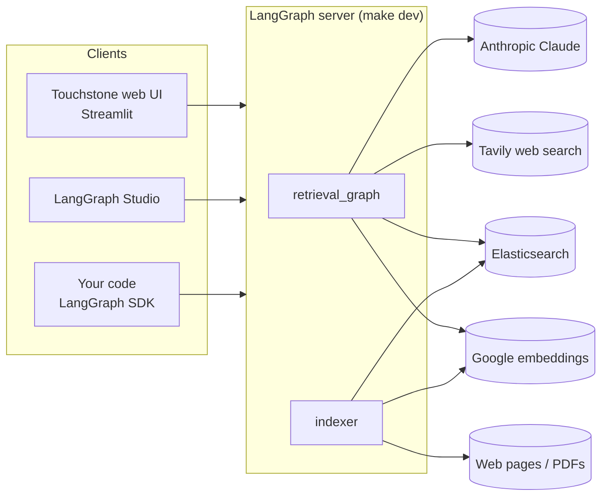
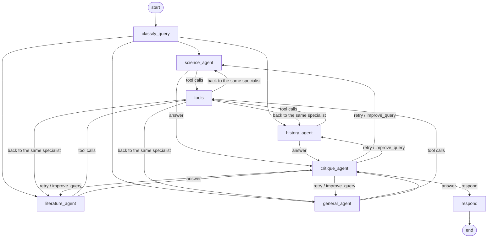
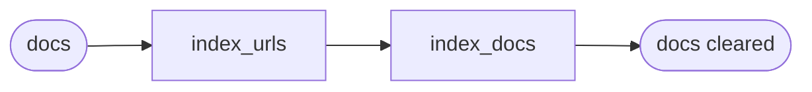

# Architecture

Touchstone is a pair of [LangGraph](https://langchain-ai.github.io/langgraph/) graphs served
by a LangGraph server, plus a web UI that talks to that server.

## System overview

- **Graphs** live in `src/retrieval_graph` and are registered in `langgraph.json`.
- **The server** is `langgraph dev` locally (in-memory persistence, hot reload, Studio);
  the same graphs deploy unchanged to LangGraph Platform.
- **The web UI** (`src/touchstone_ui`) never imports the graphs. It uses the LangGraph
  API like Studio does, so it works against a deployed server too.

## Retrieval graph (`retrieval_graph`)

| Node | Model | What it does |
| --- | --- | --- |
| `classify_query` | `query_model` | Classifies the latest question as `science`, `history`, `literature` or `general` and **resets the per-turn state** (see below). |
| `<subject>_agent` | `response_model` | Answers with a subject-specific prompt. May call `retrieve_documents` and `web_search`. |
| `tools` | - | Runs the requested searches and stores the results in `retrieved_docs`. |
| `critique_agent` | `response_model` | Returns `respond`, `retry` or `improve_query` with feedback. |
| `respond` | - | Adds the accepted draft to the conversation as the final answer. |

### What a specialist sees

Each specialist call renders its prompt (in `prompts.py`) from three values:

- `question` - the **latest** human message;
- `retrieved_docs` - the documents found so far in this turn, formatted with a token
  budget, or an instruction about searching (below);
- `critique_feedback` - the critic's feedback when retrying.

The conversation history itself is not sent to the models. Each question is answered on its
own, which keeps prompts small and predictable. Follow-ups that depend on an earlier answer
("tell me more") therefore need to restate the topic.

### Tools

| Tool | Backend | Notes |
| --- | --- | --- |
| `retrieve_documents` | Elasticsearch kNN search in the `langchain_index` index | Filtered to the user's documents; `k` from `search_kwargs` (default 1); each document truncated to 3,000 characters |
| `web_search` | Tavily via `langchain-tavily` (3 results, `advanced` depth: 2 API credits per search) | Only offered when `enable_web_search` is true; results truncated to 2,000 characters |

The tools are bound to the specialist models so they can request a search, but the
searches run in the `tools` node (`handle_tool_calls`). Only the 5 most recent documents are
kept in state.

### Guardrails (one user turn)

Without these limits, an empty knowledge base, a failing search or a strict critic would
make the run loop until LangGraph aborted it with a `GraphRecursionError`:

| Situation | Behaviour |
| --- | --- |
| No documents yet | The specialist is told to search the knowledge base. |
| A search ran and found nothing | It is told to answer from its own knowledge instead. |
| `MAX_TOOL_ROUNDS` (3) search rounds used | Tools are withdrawn; the specialist must answer. |
| The critic asked for `MAX_CRITIQUE_RETRIES` (2) retries | The latest draft is returned. |

Both counters are derived from the messages since the latest human message, so they need no
extra state. They live in `graph.py`.

### State

`State` (in `state.py`) is a dataclass:

| Field | Set by | Notes |
| --- | --- | --- |
| `messages` | everyone | `add_messages` reducer: questions, tool calls, tool results, drafts, final answer |
| `classification` | `classify_query` | subject of the current question |
| `retrieved_docs` | `tools` | documents for the current question (reset each turn) |
| `agent_response` | specialists | latest draft text (reset each turn) |
| `critique_decision`, `critique_feedback` | `critique_agent` | latest verdict (reset each turn) |

In a persistent thread (Studio or the web UI), state carries over between questions.
`classify_query` therefore clears `retrieved_docs`, `agent_response` and the critique
fields at the start of every turn. Otherwise one question's documents and feedback would
leak into the next.

The input schema (`InputState`) only exposes `messages`.

## Indexing graph (`indexer`)

1. **`index_urls`** picks out documents that are a single `http(s)://` URL, downloads them
   concurrently (60-second timeout each), extracts text (PDFs with `pypdf`, HTML with
   BeautifulSoup) and indexes every page with at least 200 characters of text. If none of
   the URLs work, the run fails with a message listing why. It then passes the remaining
   plain-text documents on.
2. **`index_docs`** indexes the plain-text documents.

Every document is stamped with `metadata.user_id`. The input can be a string, a list of
strings and/or `{"page_content": ..., "metadata": {...}}` objects (see `reduce_docs`).

## Data isolation

All users share one Elasticsearch index. Every search is filtered with an exact match on
`metadata.user_id.keyword`, so a user only sees documents indexed under the same ID.

> **Note:** the user ID selects a knowledge base but is **not authentication**. Anyone who
> can reach the server or the UI can type any user ID. Put a deployment behind
> authentication, for example with
> [LangGraph custom auth](https://langchain-ai.github.io/langgraph/concepts/auth/), before
> storing anything private.

## Design decisions

| Decision | Why |
| --- | --- |
| The UI is an API client, not an in-process caller | One backend serves Studio, the UI and deployments; threads persist on the server; the UI process stays light. |
| `config_schema` is kept although LangGraph 1.x deprecates it | Moving to `context_schema` changes how every caller passes settings (`configurable` -> `context`). Do it as a deliberate migration before LangGraph 2.0. |
| Async Elasticsearch client per search, closed in an `async with` | No event-loop juggling or threads, and no leaked connections. |
| Loop counters derived from messages | No new state fields, and they work with any checkpointer. |
| Specialists share one implementation (`SPECIALISTS` registry) | Adding a subject is a prompt plus a registry entry. See [Development](development.md#add-a-specialist-agent). |
