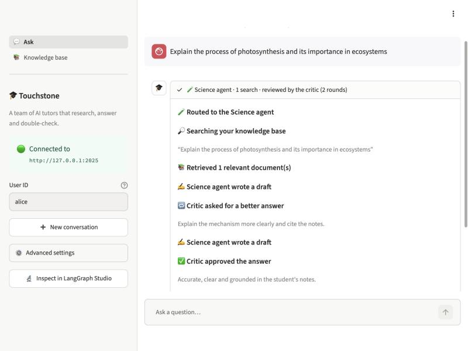

# Web UI

The Touchstone web UI is a [Streamlit](https://streamlit.io/) app for students and
teachers. It covers asking questions, watching the agents work and managing a knowledge
base.



## Start it

```bash
make start   # backend + UI together; opens http://localhost:8501
```

Or run them separately, which is handy while developing the graphs:

```bash
make dev     # terminal 1: LangGraph server on :2024 (+ LangGraph Studio)
make ui      # terminal 2: UI on :8501
```

Ports can be changed: `make start API_PORT=2025 UI_PORT=8502`.

## Pages

**Sidebar**

- Connection status for the backend, with instructions when it isn't running.
- **User ID** - selects whose knowledge base is used. Switching users starts a new
  conversation.
- **New conversation** - forgets the chat and starts a new server thread.
- **Advanced settings** - override the answer model, the routing model and whether web
  search is allowed, for this browser session.
- **Inspect in LangGraph Studio** - opens Studio connected to the same server, to see the
  graph and state of every run.

**Ask**

Type a question or pick an example. While the agents work, a live trace shows each step:
routing, searches and their results, drafts and the critic's verdicts. Once the answer
arrives, the trace collapses into a one-line summary (for example "🧪 Science agent · 1
search · reviewed by the critic") that you can expand. Sources used for the answer are
listed under it.

**Knowledge base**

Add study material for the current user:

- **Paste text** - optionally one document per paragraph, which makes search results more
  precise.
- **Web pages & PDFs** - one URL per line; each is downloaded and its text extracted.
- **Upload files** - `.txt` and `.md` files. For PDFs, use a URL.

## How it connects

The UI calls the LangGraph API with the [LangGraph SDK](https://pypi.org/project/langgraph-sdk/)
- the same API LangGraph Studio uses:

- questions stream from `retrieval_graph` (`stream_mode="updates"`) in a server-side thread;
- documents go to `indexer` as a one-off run.

To use a deployed server, set `TOUCHSTONE_API_URL` (and `LANGSMITH_API_KEY` for
LangGraph Platform) and run `make ui`.

> **The user ID is not authentication.** Anyone who can open the UI can type any user ID.
> Do not expose it publicly without putting authentication in front of it.

## Code map

```text
src/touchstone_ui/
  app.py          entry point: page setup, sidebar, navigation
  client.py       LangGraph SDK wrapper (ask, index, health check)
  events.py       turns stream updates into trace steps, sources and the answer
  documents.py    splitting pasted text, parsing URLs, decoding uploads
  settings.py     TOUCHSTONE_API_URL / USER_ID from the environment
  views/          sidebar.py, chat.py ("Ask"), knowledge.py ("Knowledge base")
```

The logic modules don't import Streamlit and are unit-tested directly. The views are
tested by running the whole app headlessly with `streamlit.testing` against a fake backend
(`tests/unit_tests/test_ui_app.py`).

## Customising

- **Theme** - `.streamlit/config.toml` (light/dark follows the viewer's system setting).
- **Example questions** - `EXAMPLES` in `views/chat.py`.
- **Subject labels and icons** - `SUBJECTS` in `events.py`. Keep them in sync when you add
  a specialist.
